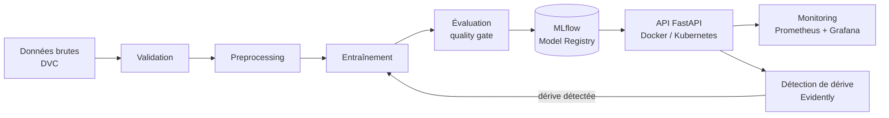

# Churn MLOps


Système de prédiction de **churn client** (attrition) appliquant les bonnes pratiques MLOps sur tout le cycle de vie : versioning, tracking, registry, API, conteneurisation, orchestration, CI/CD, monitoring et détection de dérive.

> Le modèle est volontairement simple. L'objectif du projet est l'**industrialisation**, pas la performance brute.

---

## Table des matières

- [Contexte et objectif](#contexte-et-objectif)
- [Métriques et critères d'acceptation](#métriques-et-critères-dacceptation)
- [Architecture](#architecture)
- [Stack technique](#stack-technique)
- [Structure du projet](#structure-du-projet)
- [Démarrage rapide](#démarrage-rapide)
- [Workflow Git](#workflow-git)
- [Roadmap](#roadmap)
- [Sécurité, gouvernance et éthique](#sécurité-gouvernance-et-éthique)
- [Auteur](#Arij khemiri)

---

## Contexte et objectif

Le **churn** désigne un client qui résilie son abonnement. Pour un opérateur télécom, conserver un client coûte nettement moins cher que d'en acquérir un nouveau.

**Problème** : prédire, à partir du profil et du comportement d'un client, la probabilité qu'il résilie.

**Valeur métier** : permettre à l'équipe marketing de cibler les clients à risque avec une offre de rétention avant leur départ.

**Données** : [Telco Customer Churn](https://www.kaggle.com/datasets/blastchar/telco-customer-churn) (≈ 7 000 clients, 20 variables : ancienneté, contrat, facturation, services souscrits, etc.).

## Métriques et critères d'acceptation

Rater un client qui part coûte plus cher que contacter un client qui serait resté. La métrique principale favorise donc le **rappel** sur la classe churn.

| Type | Métrique | Seuil |
|------|----------|-------|
| Principale | Recall (classe churn) | ≥ 0.75 |
| Secondaires | F1-score, ROC-AUC, précision | suivis, sans seuil bloquant |

Le seuil de recall sert de **quality gate** : un modèle qui ne l'atteint pas ne peut ni être promu dans le registry ni être déployé par la CI.

## Architecture



## Stack technique

| Domaine | Outils |
|---------|--------|
| Versioning code / données | Git, GitHub, DVC |
| Tracking et registry | MLflow |
| ML | scikit-learn, XGBoost |
| API | FastAPI, Pydantic |
| Conteneurisation | Docker, Docker Compose |
| Orchestration | Prefect / Airflow ou `dvc.yaml` |
| Déploiement | Kubernetes (minikube / kind) |
| CI/CD | GitHub Actions |
| Monitoring | Prometheus, Grafana |
| Dérive | Evidently |
| Qualité et sécurité | pytest, ruff, Bandit, pip-audit |

## Structure du projet

```
churn-mlops/
├── .github/workflows/   # pipelines CI/CD
├── configs/             # paramètres en YAML
├── data/
│   ├── raw/             # données brutes (suivies par DVC)
│   └── processed/       # données transformées
├── docker/              # Dockerfiles et docker-compose
├── docs/                # model card, schémas d'architecture
├── k8s/                 # manifests Kubernetes
├── pipelines/           # DAGs d'orchestration
├── src/
│   ├── data/            # ingestion et validation
│   ├── features/        # preprocessing
│   ├── training/        # entraînement et évaluation
│   ├── api/             # service de prédiction
│   └── monitoring/      # métriques et dérive
├── tests/               # tests unitaires, données, modèle
├── requirements.txt
└── README.md
```

## Démarrage rapide

### Prérequis

- Python 3.10+
- Git
- Docker (pour les étapes de conteneurisation)

### Installation

```bash
git clone https://github.com/<arijkhemiri2002>/churn-mlops.git
cd churn-mlops

python -m venv .venv
source .venv/bin/activate        # Windows : .venv\Scripts\activate
pip install -r requirements.txt
```

### Récupérer les données

```bash
dvc pull
```

> Le remote DVC est pour l'instant un dossier local. Il sera remplacé par un remote partagé (DagsHub, S3 ou Google Drive).

### Lancer un entraînement et suivre les runs

*(disponible à partir du chapitre 3)*

```bash
mlflow ui
```

## Workflow Git

| Branche | Rôle |
|---------|------|
| `main` | stable, c'est ce qui est déployé |
| `develop` | intégration |
| `feature/*` | une branche par tâche, fusionnée via Pull Request |

Convention de commits : `feat:`, `fix:`, `docs:`, `ci:`, `chore:`, `test:`, `refactor:`.

## Roadmap

- [x] **1. Cadrage** : problème, métriques, cycle de vie
- [x] **2. Versioning** : Git et DVC
- [ ] **3. Tracking** : expériences MLflow
- [ ] **4. Model Registry** : promotion Staging → Production
- [ ] **5. API** : service FastAPI (`/predict`, `/health`, `/metrics`)
- [ ] **6. Docker** : image multi-stage et stack docker-compose
- [ ] **7. Orchestration** : pipeline ingest → train → register
- [ ] **8. Kubernetes** : Deployment, Service, HPA
- [ ] **9. CI** : lint, tests, quality gate, build
- [ ] **10. CD / CT** : déploiement et réentraînement automatiques
- [ ] **11. Monitoring** : latence, erreurs, distribution des prédictions
- [ ] **12. Dérive** : data drift et concept drift
- [ ] **13. Sécurité et éthique** : secrets, scan de dépendances, model card, biais
- [ ] **14. Synthèse** : documentation finale et soutenance

## Sécurité, gouvernance et éthique

- Aucun secret dans le dépôt (variables d'environnement, GitHub Secrets).
- Dépendances figées (`requirements.lock.txt`) et analysées (pip-audit, Bandit).
- Une **model card** documentera l'usage prévu, les limites et les performances.
- Un audit de biais sera mené sur des groupes sensibles (genre, personnes âgées).

## Auteur

**Arij** · [GitHub](https://github.com/arijkhemiri2002)